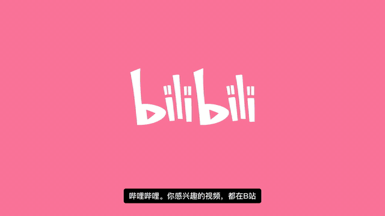
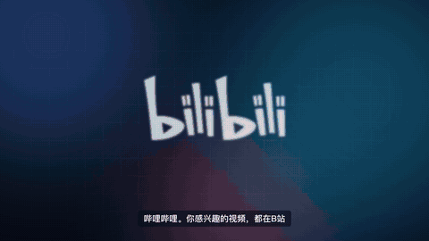
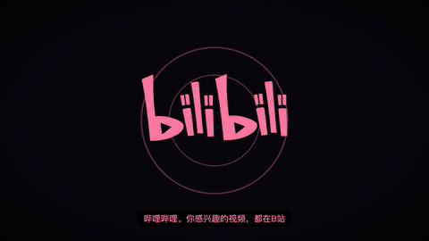
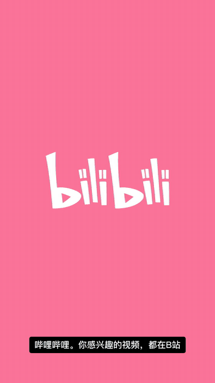
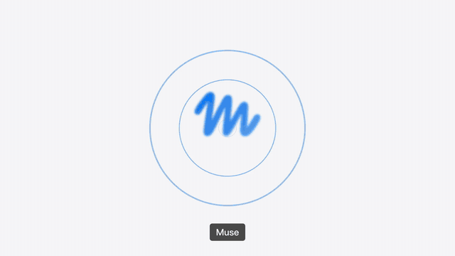
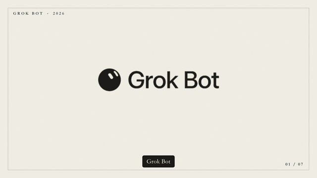
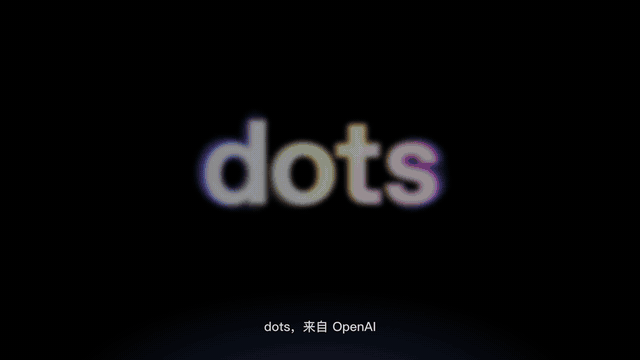
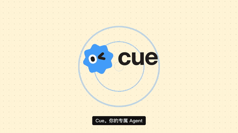

<h1 align="center">Store Release Kits</h1>

<p align="center"><code>store-release-kits</code></p>

<p align="center"><em>「代码写完以后，把上架和宣传也认真做完。」</em></p>

<p align="center">
  
  
  
  
</p>

<p align="center">
  License：未声明 · Codex / Claude Code Skills · <a href="https://github.com/SpaceZephyr/store-release-kits/issues">Issues</a>
</p>

一组围绕「产品上架和宣传」的 Skills，共五个：

| Skill | 做什么 | 主要产出 |
| --- | --- | --- |
| [`product-promo-video`](product-promo-video/) | 产品宣传视频 | 从官网抓 logo、slogan、主色、界面图，生成带动效、配音、字幕、配乐的宣传片。八种动效风格，横竖版一键切换 |
| [`store-promo-shots`](store-promo-shots/) | 商店宣传图 | 把真实截图批量合成成宣传图：八种版式、六套主题，一次出全套尺寸 |
| [`app-store-release-kit`](app-store-release-kit/) | Apple App Store 上架 | App 图标、多设备截图、元数据、App Privacy、Review Notes、TestFlight 与发布检查 |
| [`wechat-miniprogram-store-kit`](wechat-miniprogram-store-kit/) | 微信小程序上架 | 小程序图标、功能截图、审核资料、隐私保护指引矩阵、域名与资质检查、发布物料包 |
| [`chrome-extension-store-kit`](chrome-extension-store-kit/) | Chrome Web Store 上架 | 多尺寸图标、截图、宣传图块、商店文案、权限理由、隐私政策、发布 ZIP |

每个目录彼此独立，可以单独安装、修改和调用。

## 安装

```bash
npx skills add SpaceZephyr/store-release-kits
```

安装时选择需要的 Skill。也可以把对应文件夹复制到 `~/.codex/skills/` 或 `~/.claude/skills/`，
或者下载 [`dist/`](dist/) 里打包好的 zip。

---

## product-promo-video：产品宣传视频

给一个官网地址（或者自己提供的产品资料），出一条 30–60 秒的宣传片 MP4：

```text
使用 $product-promo-video，根据 https://example.com 给这个产品做一条 40 秒的宣传视频，出两种风格。
```

它会做这几件事：

1. **抓素材**：用真实浏览器打开官网，拿到 logo（优先矢量 SVG）、主色、标题和描述、桌面和手机截图、正文里的界面图。
   logo 只出现在宣传图里时，用 `extract_logo.py` 抠成透明底。
2. **写脚本**：`brief.json` 里每一场写屏幕文案和旁白。logo、slogan、使用场景、真实界面都要出现，数据要有出处。
3. **配音和配乐**：旁白用 edge-tts，不可用时退回 macOS 婷婷；每一场的时长跟着旁白走。配乐按风格合成，旁白响起时自动压低。
4. **渲染**：画面是 HTML/CSS 动效，无头 Chrome 逐帧截图后交给 ffmpeg，文字清晰，每一帧都能复现。
   先出每场静帧检查，再出成片。

八种动效风格，同一份脚本加 `--style` 就能换，加 `--format 9:16` 出竖版：

| 风格 | 画面 | 适合 |
| --- | --- | --- |
| `apple-keynote` | 黑底大字，模糊淡入，节奏慢 | 硬件、旗舰功能、高端品牌 |
| `saas-glow` | 深色光斑网格，截图 3D 立起来 | 软件、AI、开发者工具 |
| `kinetic` | 巨字砸入，闪切，每场换底色 | 短视频投放、活动、年轻品牌 |
| `flat-mg` | 几何图形漂浮，逐字弹跳，色块转场 | 消费 App、社区、教育 |
| `editorial` | 纸感衬线，遮罩上推，页码 | 内容、文化、生活方式 |
| `neo-brutal` | 粗描边硬投影，阶梯运动 | 独立开发、创意工具 |
| `cyber-glitch` | 霓虹扫描线，乱码解码，故障转场 | 游戏、电竞、潮流科技 |
| `bento` | 浅灰圆角卡片，缩放入场 | 功能多的产品、效率工具 |

片子里不出现 emoji，卡片图标用 [Lucide](https://lucide.dev/icons) 线性图标，渲染前会自动扫描整份脚本。

### 案例

五个真实产品，素材都从官网和官方发布文章里来。下面的动图截取了每一场的开头，点动图下载完整成片（带配音），
全部视频在 [Releases](https://github.com/SpaceZephyr/store-release-kits/releases/tag/product-promo-video-examples)。

**哔哩哔哩**：同一份脚本出了四种风格和一个竖版，用来对比风格差异。数据来自 2026 年第二季度财报。

<a href="https://github.com/SpaceZephyr/store-release-kits/releases/download/product-promo-video-examples/bilibili-flat-mg-16x9.mp4"></a>

<table>
  <tr>
    <td width="50%" align="center"><b>kinetic</b><br><a href="https://github.com/SpaceZephyr/store-release-kits/releases/download/product-promo-video-examples/bilibili-kinetic-16x9.mp4"></a></td>
    <td width="50%" align="center"><b>saas-glow</b><br><a href="https://github.com/SpaceZephyr/store-release-kits/releases/download/product-promo-video-examples/bilibili-saas-glow-16x9.mp4"></a></td>
  </tr>
  <tr>
    <td width="50%" align="center"><b>cyber-glitch</b><br><a href="https://github.com/SpaceZephyr/store-release-kits/releases/download/product-promo-video-examples/bilibili-cyber-glitch-16x9.mp4"></a></td>
    <td width="50%" align="center"><b>kinetic 竖版</b><br><a href="https://github.com/SpaceZephyr/store-release-kits/releases/download/product-promo-video-examples/bilibili-kinetic-9x16.mp4"></a></td>
  </tr>
</table>

**四个 AI 智能体产品**：都是 2026 年 8–9 月发布的，各用一种风格。

<table>
  <tr>
    <td width="50%" align="center"><b>Meta Muse · bento</b><br><a href="https://github.com/SpaceZephyr/store-release-kits/releases/download/product-promo-video-examples/muse-bento-16x9.mp4"></a></td>
    <td width="50%" align="center"><b>Grok Bot · editorial</b><br><a href="https://github.com/SpaceZephyr/store-release-kits/releases/download/product-promo-video-examples/grok-bot-editorial-16x9.mp4"></a></td>
  </tr>
  <tr>
    <td width="50%" align="center"><b>OpenAI dots · apple-keynote</b><br><a href="https://github.com/SpaceZephyr/store-release-kits/releases/download/product-promo-video-examples/dots-apple-keynote-16x9.mp4"></a></td>
    <td width="50%" align="center"><b>Manus Cue · neo-brutal</b><br><a href="https://github.com/SpaceZephyr/store-release-kits/releases/download/product-promo-video-examples/cue-neo-brutal-16x9.mp4"></a></td>
  </tr>
</table>

| 产品 | 风格 | 时长 | 成片 |
| --- | --- | --- | --- |
| 哔哩哔哩 | `flat-mg` | 47s | [下载](https://github.com/SpaceZephyr/store-release-kits/releases/download/product-promo-video-examples/bilibili-flat-mg-16x9.mp4) |
| 哔哩哔哩 | `kinetic` | 41s | [横版](https://github.com/SpaceZephyr/store-release-kits/releases/download/product-promo-video-examples/bilibili-kinetic-16x9.mp4) · [竖版](https://github.com/SpaceZephyr/store-release-kits/releases/download/product-promo-video-examples/bilibili-kinetic-9x16.mp4) |
| 哔哩哔哩 | `saas-glow` | 47s | [下载](https://github.com/SpaceZephyr/store-release-kits/releases/download/product-promo-video-examples/bilibili-saas-glow-16x9.mp4) |
| 哔哩哔哩 | `cyber-glitch` | 45s | [下载](https://github.com/SpaceZephyr/store-release-kits/releases/download/product-promo-video-examples/bilibili-cyber-glitch-16x9.mp4) |
| Meta Muse | `bento` | 40s | [下载](https://github.com/SpaceZephyr/store-release-kits/releases/download/product-promo-video-examples/muse-bento-16x9.mp4) |
| SpaceXAI Grok Bot | `editorial` | 44s | [下载](https://github.com/SpaceZephyr/store-release-kits/releases/download/product-promo-video-examples/grok-bot-editorial-16x9.mp4) |
| OpenAI dots | `apple-keynote` | 45s | [下载](https://github.com/SpaceZephyr/store-release-kits/releases/download/product-promo-video-examples/dots-apple-keynote-16x9.mp4) |
| Manus Cue | `neo-brutal` | 39s | [下载](https://github.com/SpaceZephyr/store-release-kits/releases/download/product-promo-video-examples/cue-neo-brutal-16x9.mp4) |

每个案例的脚本、用到的素材和制作说明在 [`product-promo-video/examples/`](product-promo-video/examples/)。

> 这些案例只用来演示 Skill，不是各公司的官方宣传片，logo、截图和产品名称的权利归各自公司所有。
> 配音是 macOS 婷婷（制作时 edge-tts 返回 403），配乐是脚本合成的临时曲，正式使用请换真人录音和授权音乐。

---

## store-promo-shots：商店宣传图

把应用的真实截图加上文案、背景和设备框，合成各商店要的宣传图，一次出全套尺寸。

```text
使用 $store-promo-shots，用 screenshots/ 里的截图做一套 App Store 宣传图，主色用 #0A84FF。
```

截图必须来自真实运行的界面，它只负责合成，不画产品里没有的界面。截图本身可以由下面三个上架 Kit 准备。

## 三个上架 Kit

给它一个真实仓库，它先读代码和配置，再按对应平台的权限、素材尺寸、隐私申报和审核流程，准备图标、截图、商店文案、
隐私政策、审核说明和发布检查包。需要进入代码仓库的文件和独立的发布物料分开保存。

```text
使用 $app-store-release-kit，为这个 iOS App 准备 App Store Connect 元数据、截图和隐私材料。
```

```text
使用 $wechat-miniprogram-store-kit，审计这个小程序仓库并生成审核与发布资料。
```

```text
使用 $chrome-extension-store-kit，为这个浏览器插件准备完整的 Chrome 商店上架物料。
```

每个 Skill 都带有自己的：

- `SKILL.md`：完整工作流和完成标准
- `scripts/`：审计、生成和校验工具
- `assets/` / `templates/`：模板
- `references/`：平台规范、风格说明和注意事项
- `agents/openai.yaml`：Codex 中的显示名称和默认调用提示

## 仓库结构

```text
├── product-promo-video/          # 产品宣传视频
│   └── examples/                 # 哔哩哔哩、Muse、Grok Bot、dots、Cue 五个案例
├── store-promo-shots/            # 商店宣传图
├── app-store-release-kit/        # App Store 上架
├── wechat-miniprogram-store-kit/ # 微信小程序上架
├── chrome-extension-store-kit/   # Chrome 商店上架
└── dist/                         # 打包好的 zip
```

## 边界

- 平台后台字段、素材规格和审核规则会变化，正式提交前仍需核对当前后台。
- 静态扫描可以发现风险，不能替代真机测试、平台构建结果或法律判断。
- Skills 不会在没有明确授权时上传构建、提交审核、发布版本或更改商店账号。
- 不要把签名证书、上传私钥、AppSecret、访问令牌或真实用户数据提交到仓库。

## License

当前仓库尚未声明开源许可证。除非仓库后续明确添加 License，请不要默认获得复制、修改或再分发权。
