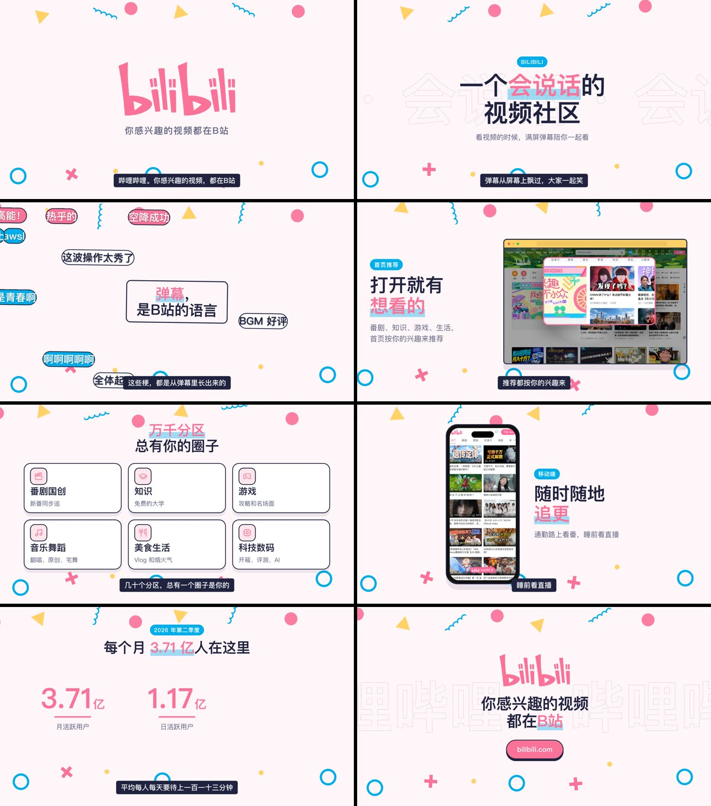
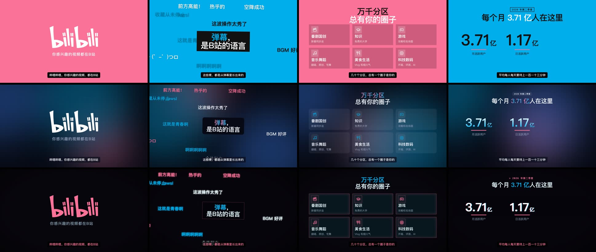
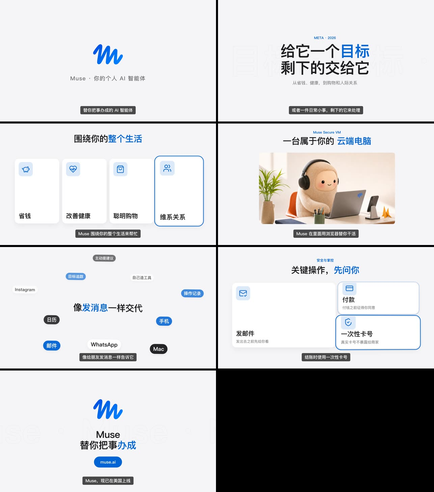
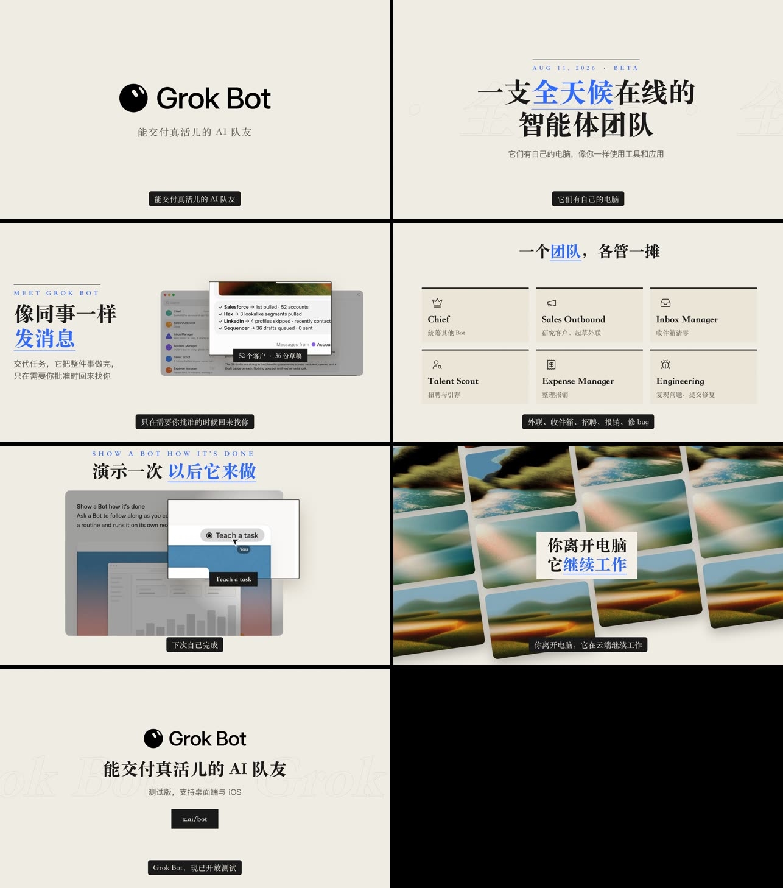
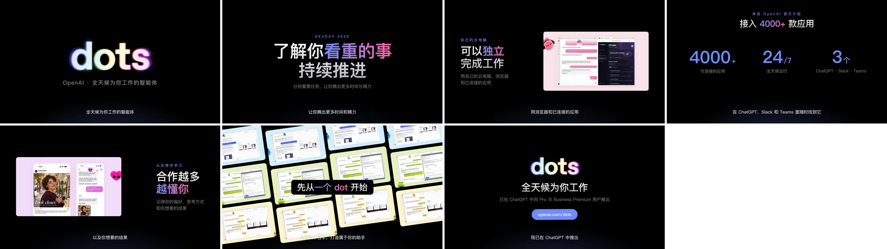
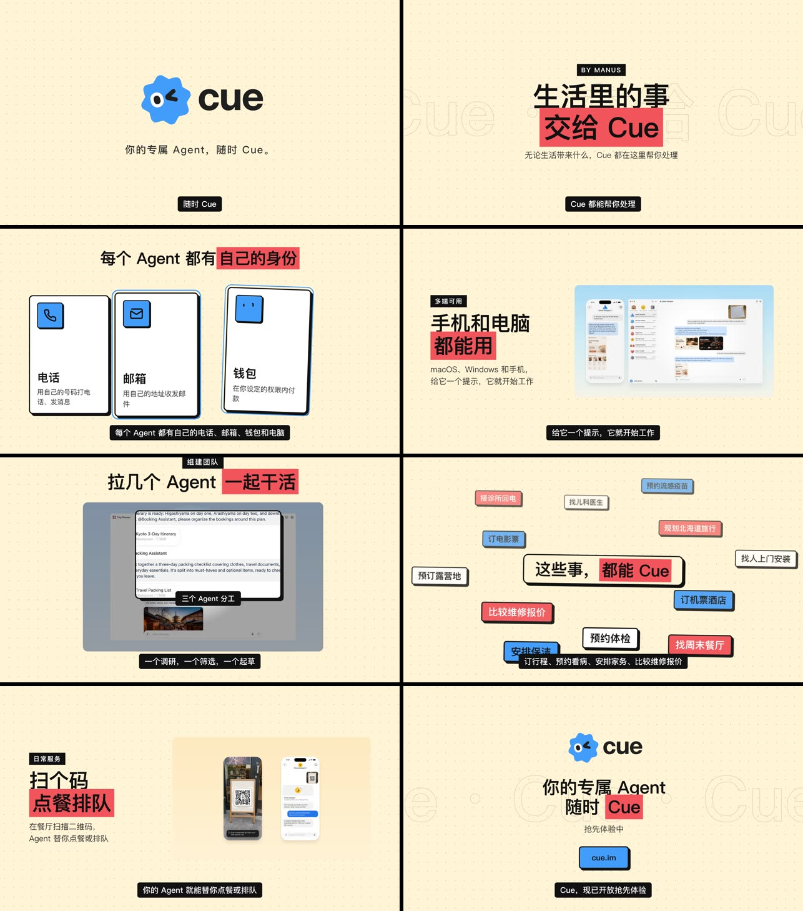

# 案例

五个真实产品，同一套 Skill。每个案例目录里有：

- `brief.json`：完整脚本（场景、屏幕文案、旁白、风格、品牌色）
- `brand/`：从官网抓下来、实际用到的素材（logo、界面图、场景图）
- `preview.jpg`：每一场的静帧总览
- `*.gif`：每一场开头 2.5 秒拼成的动图（5MB 以内，无声）

成片视频在 [Releases · product-promo-video-examples](https://github.com/SpaceZephyr/store-release-kits/releases/tag/product-promo-video-examples)。

自己重跑：

```bash
cd ../scripts && npm install --silent && cd ../examples/cue
python3 ../../scripts/make.py brief.json --preview        # 先看静帧
python3 ../../scripts/make.py brief.json                  # 出成片
python3 ../../scripts/make.py brief.json --style kinetic  # 同一份脚本换风格
```

| 案例 | 风格 | 时长 | 素材来源 |
| --- | --- | --- | --- |
| [哔哩哔哩](bilibili/) | `flat-mg` `kinetic` `saas-glow` `cyber-glitch`，另有 `kinetic` 竖版 | 41–47s | bilibili.com 首页与手机版、app.bilibili.com 矢量 logo、2026 年二季度财报 |
| [Meta Muse](muse/) | `bento` | 40s | muse.ai |
| [Grok Bot](grok-bot/) | `editorial` | 44s | x.ai/bot、x.ai/news/introducing-grok-bot |
| [OpenAI dots](dots/) | `apple-keynote` | 45s | openai.com/dots |
| [Manus Cue](cue/) | `neo-brutal` | 39s | cue.im、manus.im/blog/introducing-manus-2-0 |

## 预览

**哔哩哔哩 · flat-mg**


**哔哩哔哩 · kinetic / saas-glow / cyber-glitch**


**Meta Muse · bento**


**Grok Bot · editorial**


**OpenAI dots · apple-keynote**


**Manus Cue · neo-brutal**


## 每个案例怎么做的

**哔哩哔哩**：首页 logo 只有 220px 宽，换成了 app.bilibili.com 导航栏里的矢量 SVG。弹幕是 B 站最有辨识度的东西，所以单独做了一场满屏飞过的弹幕。
数据用的是 2026 年第二季度财报（月活 3.71 亿、日活 1.17 亿、人均每天 113 分钟）。同一份 brief 出了四种风格和一个竖版，用来对比风格差异。

**Muse**：官网首页基本是登录框，可用的视觉是吉祥物和 og 图。所以这条以「生活场景卡片 + 云端电脑 + 安全控制」为主线，用干净的 bento 风格。没有放任何用户数据，因为查到的数字都来自二手报道。

**Grok Bot**：`x.ai/grok-bot` 是 404，后来找到产品页 `x.ai/bot` 和发布文章。应用窗口截图里的 Bot 列表（Chief、Sales Outbound、Inbox Manager……）直接做成了团队卡片。
logo 只出现在 og 图里，用 `extract_logo.py --mode white` 抠出来，再用 CSS 压成黑色，放在 editorial 的米白底上。

**dots**：OpenAI 的发布文章里有 6 张官方界面图，是这次素材最好的一个。官方主视觉是黑底彩色发光字，所以配 apple-keynote 的黑底，logo 用 `--mode on-dark` 抠出来，保留了发光效果。

**Cue**：`manus.im/cue` 是 404，从 Manus 2.0 发布文章的链接里找到独立官网 cue.im，中文 slogan「你的专属 Agent，随时 Cue。」和电话、邮箱、钱包、电脑四项身份能力都来自那里。
吉祥物是蓝、黄、红三色，配色大胆，所以用 neo-brutal。

## 说明

- 这些案例用来演示 Skill 的能力，**不是各公司的官方宣传片**。logo、界面截图和产品名称的权利归各自公司所有。
- 配音用的是 macOS 婷婷（制作时 edge-tts 接口返回 403），配乐是 `bgm.py` 合成的临时曲。正式使用请换真人录音和授权音乐。
- 产品信息以 2026 年 10 月官网内容为准，之后可能变化。
